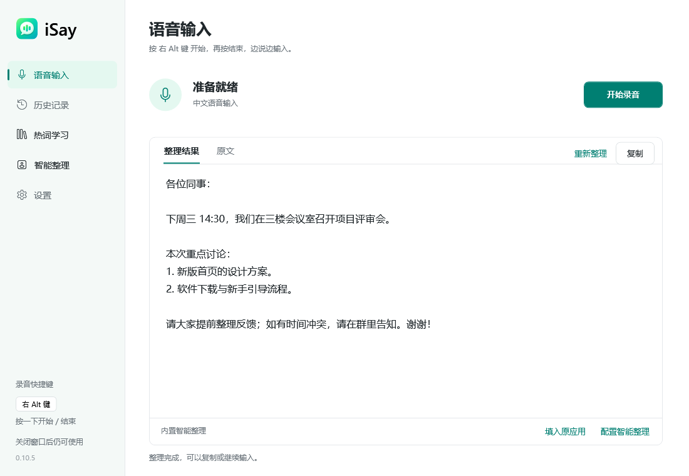
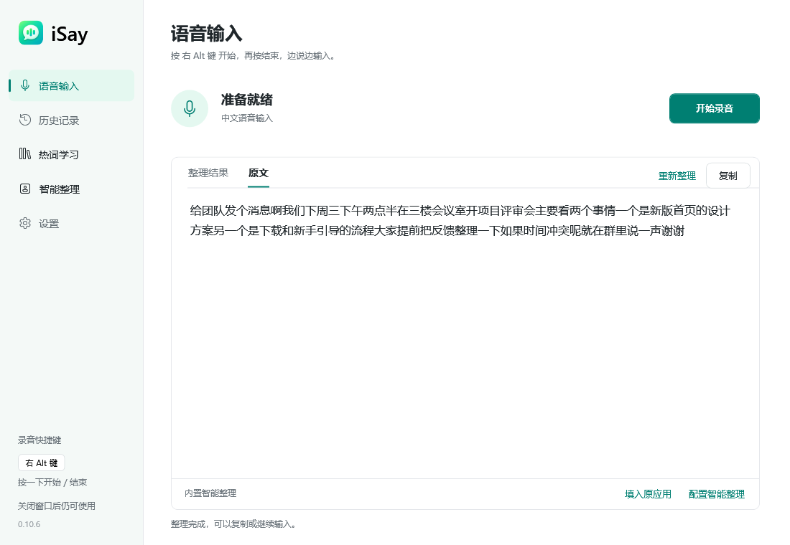
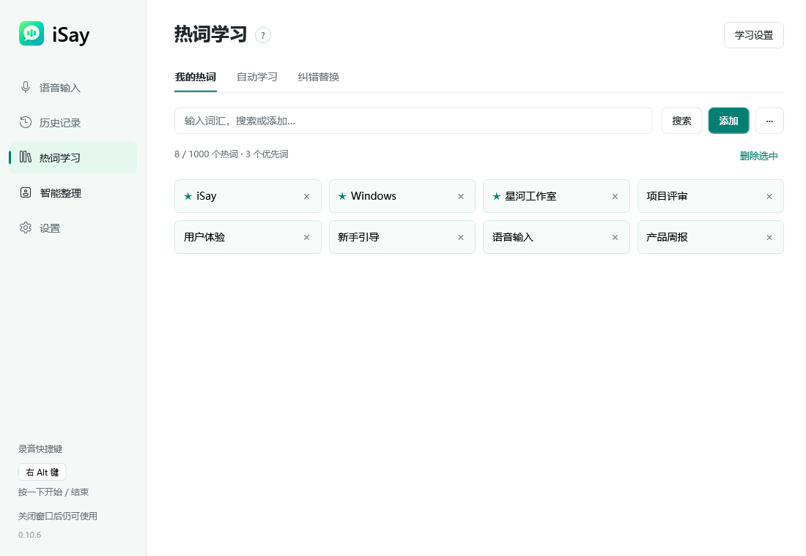
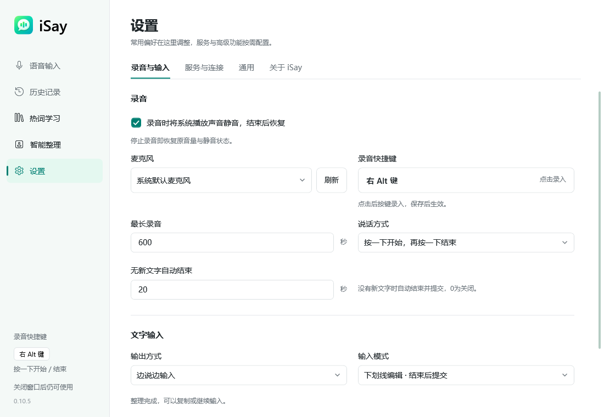

[简体中文](./README.md)

#  iSay · Chinese voice input at its best · Free forever

**Your next sentence doesn't need to be typed one character at a time.**

iSay brings multilingual voice input to your Windows desktop. Press Right Alt, speak naturally, and keep your words moving with your thoughts. Refine the result, manage your vocabulary, and return to your local history when you need it.

**Free forever · Built for Windows · Multilingual voice input**

[**Download for Windows →**](https://github.com/Diorser/iSay/releases/download/v0.10.7-installer-preview/iSay-0.10.7-win-x64-full.exe) · [Website](https://isay-voice.pages.dev/en/) · [Get started](#three-steps-from-speech-to-text) · [Feedback](https://github.com/Diorser/iSay/issues)

Windows 10 / 11 · x64 · Installer preview 0.10.7 · Full installer: 192.29 MiB

## Stay with your thoughts

Reply to a message, draft an email, capture an idea, or work through a longer piece of writing. Say what you mean; iSay turns it into text you can keep editing.

| What you want to do | How iSay helps |
|---|---|
| Speak instead of typing every character | Press Right Alt to start, then press it again to finish. Text appears in supported input fields; output after recording and copying are also available. |
| Turn spoken words into readable text | Choose natural formatting or basic transcription. Adjust punctuation, Chinese–English spacing and filler handling while keeping the original transcript for comparison. Clear-paragraph formatting is also available with a custom compatible endpoint. |
| Keep names and specialist terms close | Manage a personal vocabulary and corrections, with vocabulary and learning options you can enable when needed. |
| Record without constantly opening the main window | A floating recording bar shows status, tray controls stay nearby, and a shortcut starts or stops recording. |
| Reuse something you said earlier | Search local transcription history and copy it again. Choose whether to save history and how long to retain it. |
| Make the app fit your habits | Customize shortcuts, choose toggle or hold-to-talk, select a microphone, mute system playback while recording, and switch between Chinese and English interfaces. |

Direct input support varies by application. Some input fields may require plain-text compatibility mode or copying the result from iSay.

## Three steps from speech to text

1. **Download and install.** Get the [complete Windows installer](https://github.com/Diorser/iSay/releases/download/v0.10.7-installer-preview/iSay-0.10.7-win-x64-full.exe) and follow the setup wizard. The .NET and VC++ installers are included; you do not need to find them separately.
2. **Choose your microphone.** Open iSay, confirm that Windows permits microphone access, and select your device.
3. **Press Right Alt and speak.** Put the cursor in a supported input field, press once to start, and press again to finish. You can also review text in iSay and copy it to your destination.

New configurations enable sign-in startup and muting system playback during recording. You can change these, the shortcut, and output behavior in Settings. Existing saved choices are preserved.

## Small details that make daily use easier

### Speak first. Refine when you're ready.

Keep your train of thought instead of stopping for every punctuation mark. Choose a formatting style, compare it with the original transcript, and refine or copy the result again.

### Your vocabulary, under your control

Keep project names, specialist terms and frequently mentioned names in a personal vocabulary. Enable the relevant vocabulary and learning options when you want them.

### Set it up once. Keep it close.

Choose a microphone and shortcut, and mute system playback while you record if you prefer. The floating bar and tray controls keep voice input within reach beyond the main window.

Screenshots use demonstration content and contain no real user data. The app interface supports both Chinese and English; the examples above show Chinese.

## Free forever. Start with a download.

The iSay desktop product is free forever. We want everyday voice input to be within everyone's reach.

This commitment covers iSay itself. If you choose to configure a third-party speech or AI API, that provider may charge separately. Third-party availability, quotas and terms are controlled by the provider; this is not a promise of permanently unlimited or offline upstream services.

## Frequently asked questions

### Which versions of Windows are supported?

The current installer targets Windows x64 and requires Windows 10 version 2004 (build 19041) or later. It is also intended for Windows 11. Installation packages for macOS, Linux and Windows ARM64 are not currently available.

### Can I dictate directly into every app?

Direct input works in supported fields. Input-component support varies by application, so universal compatibility is not promised. Try plain-text compatibility mode or copy the result from iSay if a field does not work as expected.

### Does it need an internet connection?

The current built-in recognition and refinement features depend on third-party components and services; full offline operation is not promised. With a custom API, connectivity, recognition languages, latency and cost depend on that service. The two interface languages do not determine the languages recognized by a speech service.

### Where are my audio and transcripts stored?

Transcription history is stored locally for 30 days by default. Audio file saving is off by default, and retention settings are adjustable. Online recognition or refinement sends the required content to the relevant service; local history does not mean all speech processing stays on the device. See the [privacy and dependency guide (Chinese)](./docs/公开/隐私与第三方依赖.md).

### Is the current release ready for unrestricted daily use?

Version 0.10.7 is still a complete installer preview. Clean Windows 10 installation and real microphone recognition have not completed acceptance testing, so try your own microphone and usual apps first. The installer has no Windows publisher signature yet. See the [release status and checksums (Chinese)](./docs/公开/完整安装包发布说明.md).

### How do I get future updates?

Starting with 0.10.6, automatic update checks are enabled by default. The first check runs 30–60 seconds after startup, then about every 12 hours. Open **Settings → About iSay** to check manually, download an update and choose when to install it. Updates are not installed automatically, and the app will not close without your choice. Finish recording and text refinement before installing.

**If you use 0.10.5 or earlier, first install the current version manually from the website or [GitHub Releases](https://github.com/Diorser/iSay/releases/tag/v0.10.7-installer-preview) to join the update channel.** Existing personal settings and switch choices are preserved. You can also turn automatic checks off in About. See the [automatic-update guide (Chinese)](./docs/公开/自动更新使用与发布.md).

### What if recording produces no text or an app is incompatible?

First use the recording button inside iSay and check your selected microphone, Windows microphone permissions and connectivity. This helps distinguish shortcut, speech-service and destination-field problems. If the issue remains, [open an issue](https://github.com/Diorser/iSay/issues) with your Windows version, iSay version, target application and reproduction steps. Remove audio, transcripts, accounts, keys, vocabulary and private paths from diagnostics before sharing them.

## Chinese voice input at its best · Free forever

If iSay fits your workflow, give the project a **Star** and share it with someone who wants to type less and express more. Found a problem or have an idea? [Tell us](https://github.com/Diorser/iSay/issues).

[**Download for Windows →**](https://github.com/Diorser/iSay/releases/download/v0.10.7-installer-preview/iSay-0.10.7-win-x64-full.exe) · [Visit the website](https://isay-voice.pages.dev/en/) · [Release notes and SHA256](https://github.com/Diorser/iSay/releases/tag/v0.10.7-installer-preview)

Developers: builds, source and checks

The project's own source is open for reading, improvements and contributions. The [build guide (Chinese)](./docs/公开/使用与构建.md) covers the toolchain, input components, compatible APIs and regression commands. The [installer release guide (Chinese)](./docs/公开/完整安装包发布说明.md) describes publishing. The public Git repository does not include third-party native binaries; cloning the source does not provide a complete service environment.

 

The project's own source is licensed under the [MIT License](./LICENSE), by [Diorser](https://github.com/Diorser). Third-party software, native components and services retain their respective rights and terms; they are outside iSay's MIT license and do not imply vendor authorization or endorsement. For attribution, the scope for which separate authorization has not been obtained, and current release information, see the [dependency notice](./scripts/发布/第三方依赖声明.txt), [privacy guide (Chinese)](./docs/公开/隐私与第三方依赖.md) and [installer release guide (Chinese)](./docs/公开/完整安装包发布说明.md).
