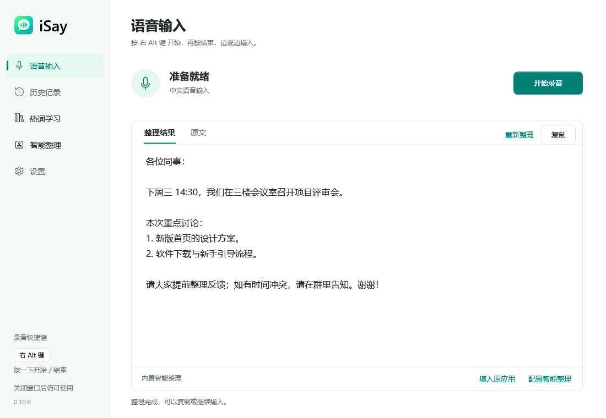
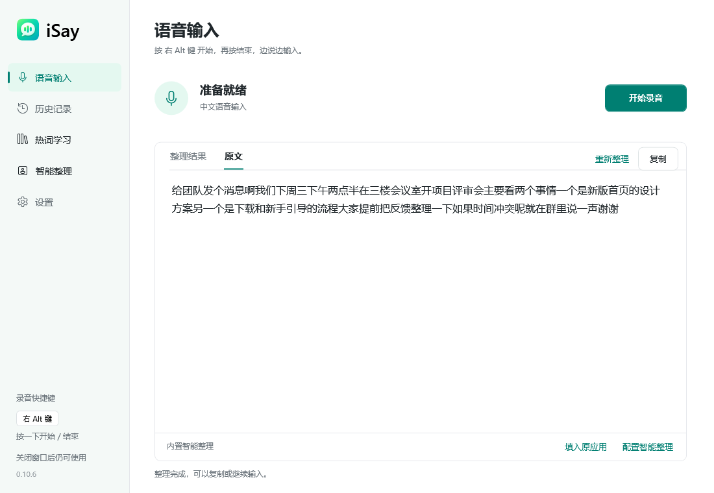
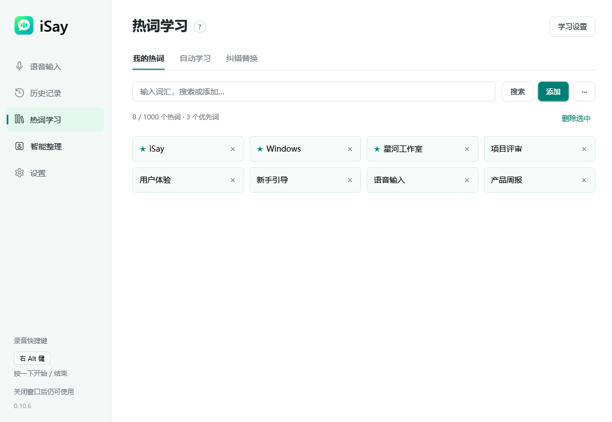
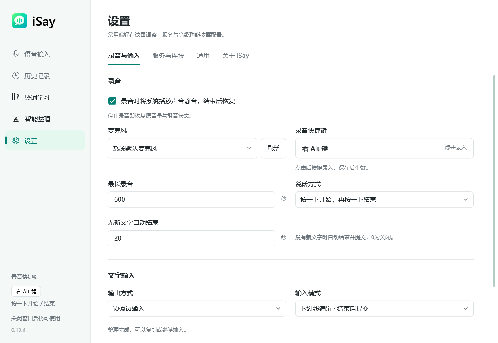

[English](./README.en.md)

#  iSay · 最好用的中文语音输入法 · 永久免费

**你的下一句话，不必再一字一字敲。**

iSay 是一款专为 Windows 打造的中文语音输入法。按下右 Alt，把想说的话自然说出来，让文字跟上思路；再用智能整理、个人词典和本地历史，把表达变成自己的样子。

**永久免费 · 专为 Windows · 中文表达优先**

[**免费下载 Windows 版 →**](https://github.com/Diorser/iSay/releases/download/v0.10.5-installer-preview/iSay-0.10.5-win-x64-full.exe) · [访问官网](https://isay-voice.pages.dev/) · [三步开始](#三步开始把说话变成输入) · [反馈与建议](https://github.com/Diorser/iSay/issues)

Windows 10 / 11 · x64 · 当前安装预览版 0.10.5 · 完整安装包 192.18 MiB

## 把注意力留给想法

写消息、回邮件、记灵感、起草长文。你负责把意思说清楚，iSay 帮你把声音变成可以继续编辑的文字。

| 你想做的事 | iSay 的方式 |
|---|---|
| 想到就说，少一点打字 | 右 Alt 一键开始、再次按下结束；在支持的输入框中实时呈现文字，也可结束后输出或复制结果。 |
| 口语先说，文字再理顺 | 选择自然整理或仅基础转写，调整标点、中英间距和语气词处理，保留识别原文供对照；自定义兼容接口还可使用清晰分段。 |
| 人名、术语和常用表达有处安放 | 管理个人词典与纠错，按需开启词汇与学习选项，积累自己的表达偏好。 |
| 不想为了录音来回切窗口 | 悬浮录音条显示状态，托盘常驻，快捷键随时启停。 |
| 刚才说过的话，还想接着用 | 在本机查看和搜索转写历史，再次复制；可设置保存与保留时间。 |
| 让工具适应自己的习惯 | 自定义快捷键、切换按下启停或按住说话、选择麦克风、录音时静音，以及中英文界面。 |

支持情况因应用输入框而异；某些输入框需要普通文本兼容模式，或通过复制结果使用。

## 三步开始，把说话变成输入

1. **下载安装。** [下载完整 Windows 安装包](https://github.com/Diorser/iSay/releases/download/v0.10.5-installer-preview/iSay-0.10.5-win-x64-full.exe)，按向导完成安装。所需的 .NET、VC++ 安装器已经随包提供，无需分别寻找下载。
2. **选好麦克风。** 打开 iSay，确认 Windows 已允许麦克风访问，选择要使用的设备。
3. **按右 Alt，开始说话。** 把光标放进支持的输入框，按一次右 Alt 开始，再按一次结束。也可以先在 iSay 中查看结果，再复制使用。

首次配置默认开启登录自启和录音时静音。快捷键、输出方式和这些偏好都可以在设置里修改；已有保存的选择会被保留。

## 好用，来自每天用得到的细节

### 先说出来，再整理成文

不必一边组织思路，一边纠结标点。先完整表达，再选择适合自己的整理风格；原文与整理结果可以对照查看，也能重新整理和复制。

### 你的词汇，你来管理

项目名称、行业术语、经常提起的人名，都可以放进个人词典。需要时再开启相关词汇与学习功能，保留自己的使用选择。

### 顺手的设置，安静地陪你工作

选好麦克风、设定常用快捷键，录音时按需静音系统播放。主窗口之外还有悬浮条和托盘，让语音输入融入日常桌面。

界面截图使用演示内容，不含真实用户资料。

## 永久免费，把门槛降到一次下载

iSay 桌面产品永久免费。我们希望语音输入成为每个人都能顺手使用的日常工具。

免费承诺适用于 iSay 产品本身。如果你主动配置第三方语音或 AI 接口，服务商可能另行计费；第三方服务的可用性、额度与条款由其提供方决定。这不代表上游服务永久、不限量或离线可用。

## 常见问题

### 支持哪些 Windows？

当前提供 Windows x64 版本，安装器要求 Windows 10 2004（系统版本 19041）及以上，也面向 Windows 11。macOS、Linux 和 Windows ARM64 暂未提供安装版。

### 可以在所有软件里直接输入吗？

在支持的输入框中可以使用直接输入。不同应用对输入组件的支持不同，暂不承诺全部软件兼容；遇到问题可尝试普通文本兼容模式，或在 iSay 中复制结果。

### 需要联网吗？

当前内置识别与整理能力依赖第三方组件和服务，不承诺全功能离线使用。使用自定义接口时，网络、识别语言、延迟与费用取决于对应服务。中英文界面不等于识别服务支持相同的语种。

### 语音和历史记录会保存在哪里？

转写历史默认保存在本机并保留 30 天，录音文件默认不保存，可以在设置中调整。联网识别或整理会由相应服务处理所需内容；“历史在本机”不代表语音始终不出本机。详见[隐私与第三方依赖](./docs/公开/隐私与第三方依赖.md)。

### 当前版本适合直接全面使用吗？

当前 0.10.5 仍为完整安装预览版。Windows 10 新机安装和真实麦克风识别尚未完成复验，建议先用自己的麦克风与常用软件试用。安装器尚无 Windows 发布者签名，客户端自动更新源尚未启用，暂通过官网或 [GitHub Release](https://github.com/Diorser/iSay/releases/tag/v0.10.5-installer-preview) 手动下载新版本。完整状态与校验文件见[发行说明](./docs/公开/完整安装包发布说明.md)。

### 录音后没有文字，或者遇到兼容问题，怎么办？

先在 iSay 界面使用录音按钮，确认麦克风选择、Windows 麦克风权限和网络；再区分快捷键、识别服务与目标输入框的问题。仍无法解决时，请在 [Issues](https://github.com/Diorser/iSay/issues) 写明 Windows 版本、iSay 版本、目标应用与复现步骤。提交诊断前请移除音频、转写正文、账号、密钥、词库和私人路径。

## 最好用的中文语音输入法 · 永久免费

觉得 iSay 顺手，欢迎给项目点一个 **Star**，也欢迎分享给同样需要少打字、多表达的朋友。发现问题、想要新功能，都可以[告诉我们](https://github.com/Diorser/iSay/issues)。

[**免费下载 Windows 版 →**](https://github.com/Diorser/iSay/releases/download/v0.10.5-installer-preview/iSay-0.10.5-win-x64-full.exe) · [查看官网](https://isay-voice.pages.dev/) · [发行说明与 SHA256](https://github.com/Diorser/iSay/releases/tag/v0.10.5-installer-preview)

开发者：构建、源码与检查

自有源码开放，欢迎阅读、改进和贡献。构建环境、双架构输入组件、兼容接口和回归命令集中在[使用与构建](./docs/公开/使用与构建.md)；发行流程见[完整安装包发布说明](./docs/公开/完整安装包发布说明.md)。公开 Git 仓库不包含第三方原生二进制，克隆源码并不等于具备完整服务环境。

 

自有源码采用 [MIT License](./LICENSE)，作者 [Diorser](https://github.com/Diorser)。第三方软件、原生组件与服务保留各自权利和适用条款，不属于 iSay 的 MIT 授权范围，也不代表得到其授权或背书。相关归属、单独授权尚未取得的范围及发行现状，见[第三方依赖声明](./scripts/发布/第三方依赖声明.txt)、[隐私说明](./docs/公开/隐私与第三方依赖.md)和[完整安装包说明](./docs/公开/完整安装包发布说明.md)。
